<p align="center">
  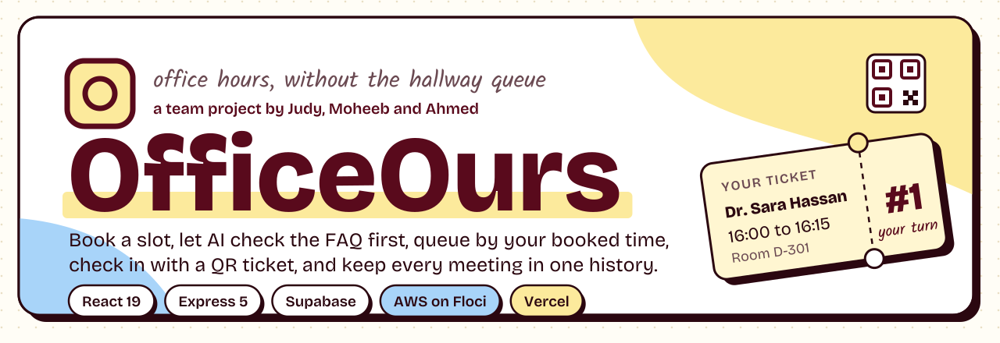
</p>

<p align="center">
  <a href="https://officeours.vercel.app/"></a>
  
  
</p>

<p align="center">
  
  
  
  
  
  
  
  
  
</p>

<p align="center">
  <a href="https://officeours.vercel.app/"><b>Live demo</b></a>
  &nbsp;|&nbsp; <a href="#how-it-works"><b>How it works</b></a>
  &nbsp;|&nbsp; <a href="#architecture"><b>Architecture</b></a>
  &nbsp;|&nbsp; <a href="#getting-started"><b>Getting started</b></a>
  &nbsp;|&nbsp; <a href="docs/openapi.yaml"><b>API contract</b></a>
  &nbsp;|&nbsp; <a href="#team"><b>Team</b></a>
</p>

<p align="center">
  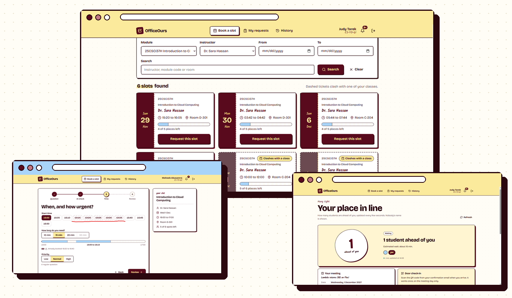
</p>

<p align="center"></p>

## About

Office hours usually run on a hallway queue: you walk over, find three people waiting, and hope you are seen before your next lecture. Instructors answer the same questions again and again, and nothing from the meeting is written down.

**OfficeOurs** turns office hours into one clear flow. Instructors publish slots, students book a time that fits their timetable, an AI check answers questions that are already in the FAQ, and on the day everyone follows a live queue ordered by booked time, with a QR ticket at the door and a shared history afterwards.

<table>
  <tr>
    <td width="50%" valign="top">
      <h3>For students</h3>
      <ul>
        <li>Only see slots for their own modules, never on weekends or public holidays</li>
        <li>Get an instant answer when the FAQ already covers the question</li>
        <li>Pick a time that nobody else has booked</li>
        <li>See their place in line and the estimated wait</li>
        <li>Keep private notes on every meeting</li>
      </ul>
    </td>
    <td width="50%" valign="top">
      <h3>For instructors</h3>
      <ul>
        <li>Publish slots once; overlaps and holidays are blocked</li>
        <li>Triage requests in an inbox with filters</li>
        <li>Run the queue on the day: call next, skip, close</li>
        <li>Grow the FAQ from AI suggestions based on real questions</li>
        <li>See everything at a glance on a dashboard</li>
      </ul>
    </td>
  </tr>
</table>

## How it works

<p align="center">
  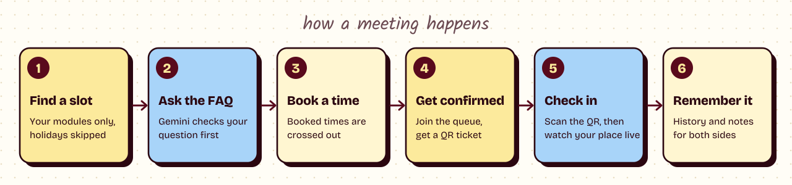
</p>

The app is split into three services that work as one product:

<table>
  <tr>
    <th width="33%">Scheduling &amp; Access</th>
    <th width="33%">Requests, FAQ &amp; Notifications</th>
    <th width="33%">Queue, QR &amp; History</th>
  </tr>
  <tr>
    <td valign="top">
      <ul>
        <li>Register and log in with a university ID</li>
        <li>Browse and search slots that fit your timetable</li>
        <li>Create, edit, cancel and delete slots</li>
        <li>Egypt public holidays (Calendarific)</li>
        <li>Instructor dashboard</li>
      </ul>
    </td>
    <td valign="top">
      <ul>
        <li>AI FAQ check before asking (Gemini)</li>
        <li>Submit, edit and cancel requests</li>
        <li>Instructor inbox: confirm and reject</li>
        <li>FAQ management and AI FAQ ideas</li>
        <li>Notification bell</li>
      </ul>
    </td>
    <td valign="top">
      <ul>
        <li>Join the queue when confirmed (event driven)</li>
        <li>Live place in line, ordered by booked time</li>
        <li>Call next, skip, close the queue</li>
        <li>QR ticket by email and door check-in</li>
        <li>Meeting history, notes and search</li>
      </ul>
    </td>
  </tr>
  <tr>
    <td valign="top"><sub>No slots on weekends, holidays or past dates. No overlapping slots. A slot with active requests is cancelled, not deleted.</sub></td>
    <td valign="top"><sub>A time cannot overlap one already confirmed. One active request per student per slot. Edits lock once the instructor opens a request.</sub></td>
    <td valign="top"><sub>Students see how many are ahead, never names. The queue only runs on the slot's day. A ticket works once, on the meeting day.</sub></td>
  </tr>
</table>

## Screenshots

<table>
  <tr>
    <td width="50%">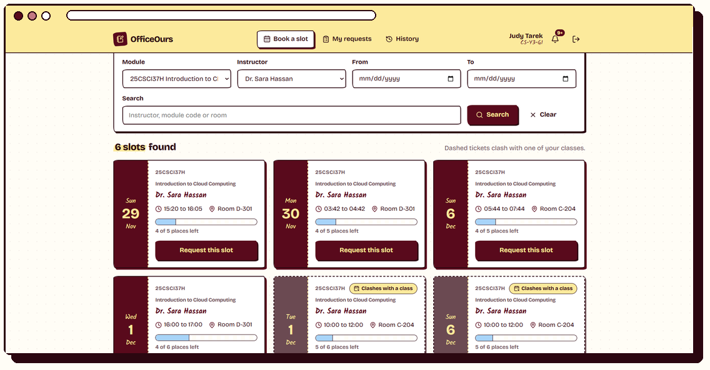<p align="center"><sub><b>Browse slots</b>: only your modules, clashes with your classes marked</sub></p></td>
    <td width="50%">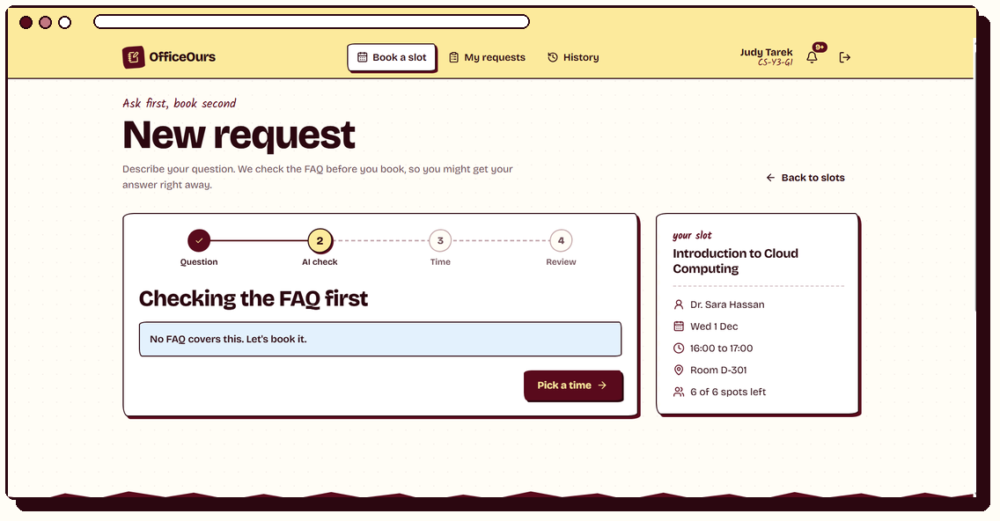<p align="center"><sub><b>AI FAQ check</b>: Gemini looks for an answer in the instructor's FAQ first</sub></p></td>
  </tr>
  <tr>
    <td>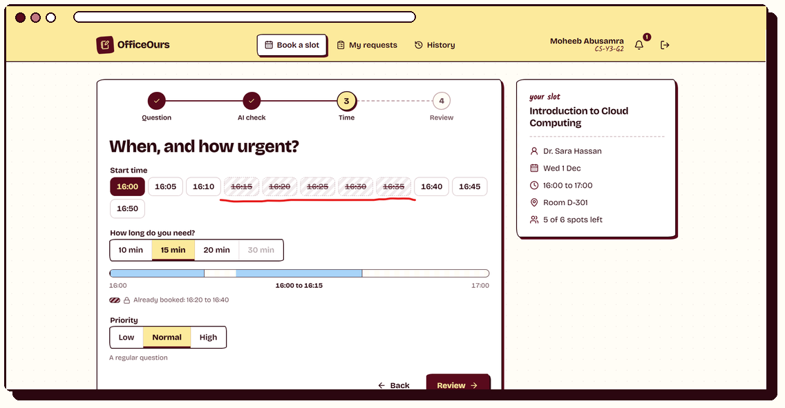<p align="center"><sub><b>Pick a time</b>: times already booked are crossed out</sub></p></td>
    <td>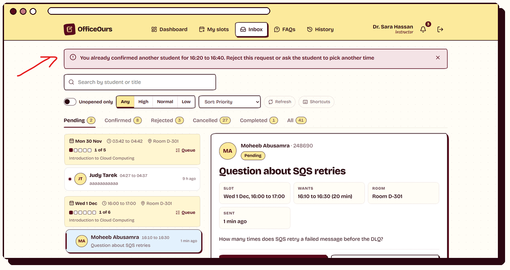<p align="center"><sub><b>Inbox</b>: confirming an overlapping time is refused</sub></p></td>
  </tr>
  <tr>
    <td>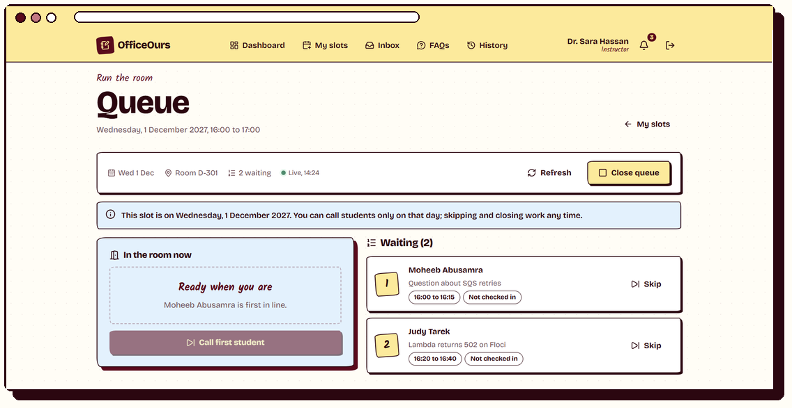<p align="center"><sub><b>Run the queue</b>: ordered by booked time, with check-in status</sub></p></td>
    <td>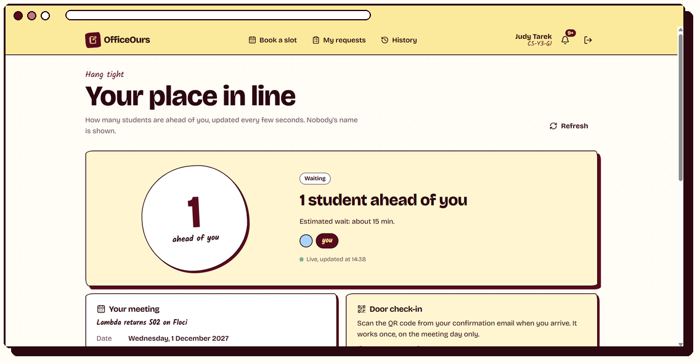<p align="center"><sub><b>Your place in line</b>: how many are ahead, never their names</sub></p></td>
  </tr>
  <tr>
    <td>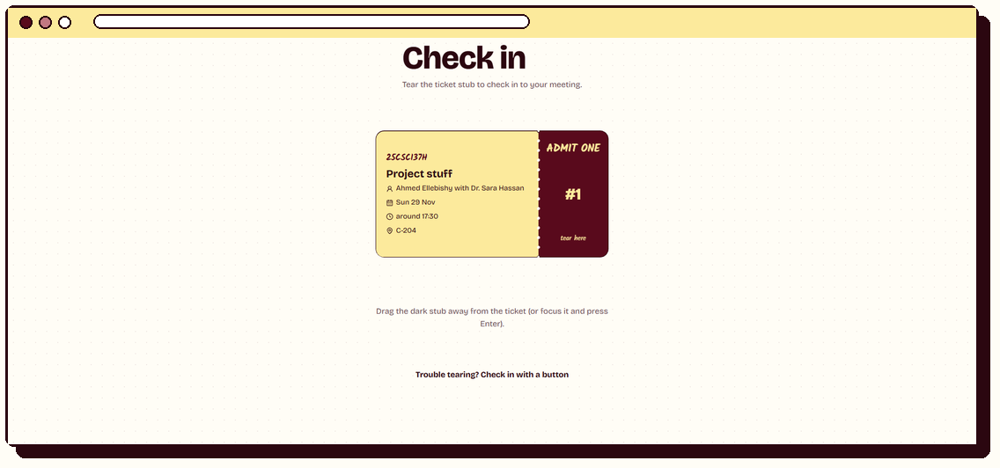<p align="center"><sub><b>Check in</b>: the QR ticket opens a door check-in page</sub></p></td>
    <td>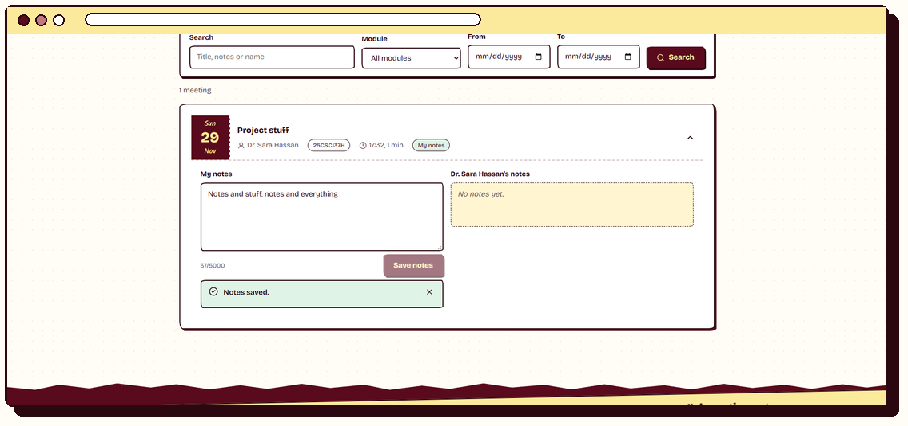<p align="center"><sub><b>History</b>: every meeting with notes from both sides</sub></p></td>
  </tr>
</table>

<details>
<summary><b>One more: AI FAQ ideas for instructors</b></summary>
<br>
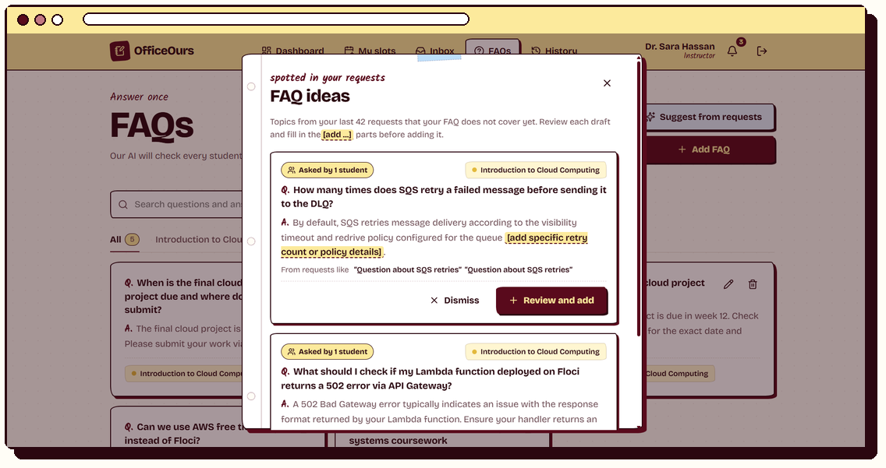
<p align="center"><sub>Gemini reads recent requests, finds topics the FAQ does not cover yet, and drafts entries with placeholders instead of invented facts.</sub></p>
</details>

<p align="center"></p>

## Architecture

The same codebase runs in **two deployments**. On Vercel the Express app is one serverless function; on Floci every service runs as AWS Lambdas behind API Gateway, talking through SNS and SQS. The server switches the AWS parts on or off from its environment, so nothing in the code changes between the two.

<table>
  <tr>
    <th></th>
    <th>Vercel + Supabase (public)</th>
    <th>Floci + Supabase (AWS)</th>
  </tr>
  <tr><td><b>Frontend</b></td><td>Vercel CDN</td><td>S3 bucket <code>officeours-web</code></td></tr>
  <tr><td><b>API</b></td><td>One Vercel Function (<code>api/index.js</code>)</td><td>API Gateway <code>officeours-api</code> + 3 Lambdas</td></tr>
  <tr><td><b>Events</b></td><td>In-process</td><td>SNS, SQS (+ DLQ), worker Lambda</td></tr>
  <tr><td><b>Data</b></td><td>Supabase Postgres + Auth</td><td>Supabase, DynamoDB, S3, SES</td></tr>
  <tr><td><b>URL</b></td><td><a href="https://officeours.vercel.app/">officeours.vercel.app</a></td><td><code>localhost:4566/officeours-web/index.html</code></td></tr>
</table>

<p align="center">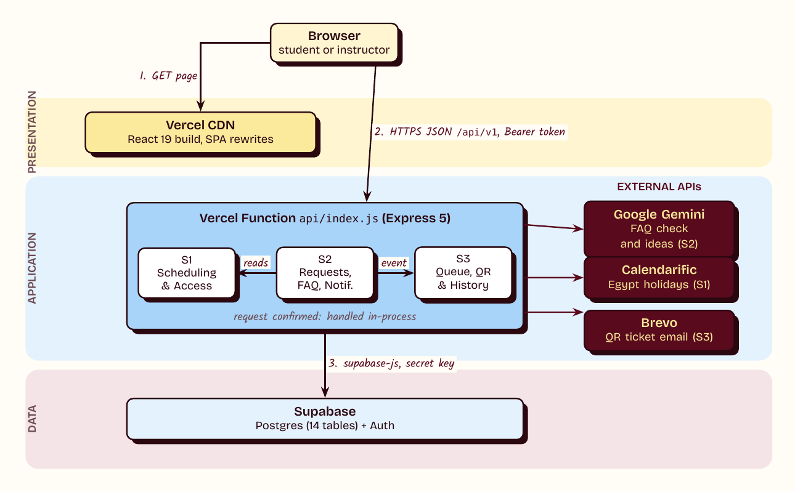</p>
<p align="center"><sub><b>Public deployment.</b> One Vercel project serves the React build and the Express API from the same address.</sub></p>

<p align="center">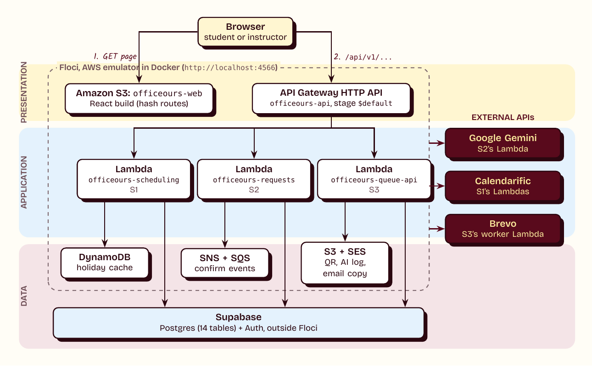</p>
<p align="center"><sub><b>AWS deployment on Floci.</b> Each Lambda wraps its service's Express routes with <code>serverless-http</code> and has its own IAM role.</sub></p>

<details>
<summary><b>Event and background flows on Floci</b></summary>
<br>
<p align="center">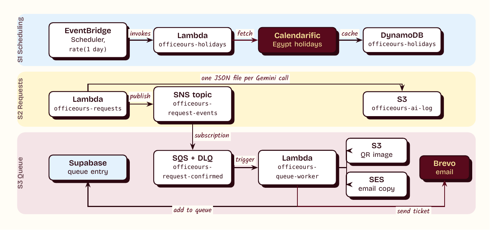</p>

| Service | AWS services | What they do |
|---|---|---|
| Scheduling | DynamoDB, Lambda, EventBridge Scheduler, API Gateway, IAM | Holiday cache refreshed daily by a scheduled Lambda |
| Requests | SNS, Lambda, API Gateway, S3, IAM | Publishes "request confirmed", logs every Gemini call to S3 |
| Queue | SQS + DLQ, Lambda, S3, SES, IAM | Queues the student, stores the QR image, keeps an email copy |
</details>

<details>
<summary><b>How the services talk to each other</b></summary>
<br>
<p align="center">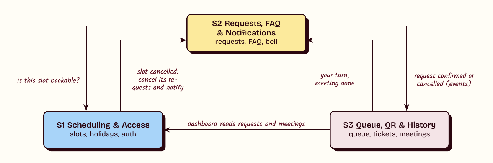</p>
</details>

### Tech stack

| Layer | Technology |
|---|---|
| Frontend | React 19, Vite 8, React Router 7, plain CSS design system, Lucide icons |
| Backend | Node.js, Express 5 (ES modules), `supabase-js`, AWS SDK v3, `serverless-http` |
| Database and auth | Supabase (Postgres, 14 tables) + Supabase Auth |
| Cloud | Floci (AWS emulator in Docker) and Vercel |
| External APIs | Google Gemini, Calendarific, Brevo |
| Testing | Jest + Supertest, Postman |

<p align="center"></p>

## Getting started

> Requires **Node.js 20.19+ or 22.12+** and a Supabase project. Docker Desktop is only needed for Floci.

```bash
# 1. install client and server
npm run install:all

# 2. environment files (fill in the values, see below)
cp client/.env.example client/.env
cp server/.env.example server/.env

# 3. in the Supabase SQL Editor run supabase/schema.sql, then supabase/seed.sql

# 4. start both apps
npm run dev        # client http://localhost:5173  |  API http://localhost:3000/api/v1
```

**Demo accounts** come from `supabase/seed.sql`: activate a seeded ID on the Register page (for example student `240101` or instructor `I-1003`) and pick any password of 8+ characters. IDs that are not in the seed are refused, just like a real university registry.

<details>
<summary><b>Run on Floci (AWS emulator)</b></summary>
<br>

```bash
docker compose up -d                      # Floci on http://localhost:4566
npm run floci:setup --prefix server       # every bucket, queue, topic, table, role, Lambda and route
# copy the printed values (AWS_ENDPOINT_URL, SQS_QUEUE_URL, SNS_TOPIC_ARN, ...) into server/.env
npm run deploy:floci --prefix server      # deploy the Lambdas and upload the frontend
```

Open `http://localhost:4566/officeours-web/index.html`. Floci keeps everything after a restart: turn it off and on with `docker stop officeours-floci` and `docker start officeours-floci`.
</details>

<details>
<summary><b>Deploy on Vercel</b></summary>
<br>

`vercel.json` already sets the install, the build, the output folder and the routing (`/api/*` to the Express function, everything else to `index.html`).

1. On vercel.com: **Add New > Project**, import this repo, framework preset **Other**, root directory `./`.
2. Add their own environmental variables.
3. Deploy, then set `CLIENT_URL` and `CHECKIN_BASE_URL` to the Vercel address and redeploy.
4. Check that `/api/v1/health` returns `{"data":{"status":"ok"}}`.

Every push to `main` redeploys automatically.
</details>


<p align="center"></p>

## Testing

| Suite | Tests | Result | Covers |
|---|:-:|:-:|---|
| `scheduling.test.js` | 47 | passing | auth, slots, weekend and holiday rules, dashboard |
| `requests.test.js` | 47 | passing | FAQ, requests, overlap rule, status workflow, notifications, AI |
| `queue.test.js` | 34 | passing | events, Lambda handler, queue order, check-in, history |
| `e2e.test.js` | 12 | 8 passing, 4 weekday-only | one full journey across all three services |
| **Total** | **140** | **136 passing, 4 skipped, 0 failing** | |

```bash
npm run dev     # the API tests call the running backend
npm test        # in a second terminal (needs TEST_PASSWORD in server/.env)
```

The Postman collection in `docs/postman/` can point at local, Floci or Vercel. Every endpoint is described in [`docs/openapi.yaml`](docs/openapi.yaml): the conventions are `{ "data" }` on success and `{ "error": { "code", "message", "details" } }` on failure, with 400, 401, 403, 404, 409 and 502 used for their real meanings.

## Database

<p align="center">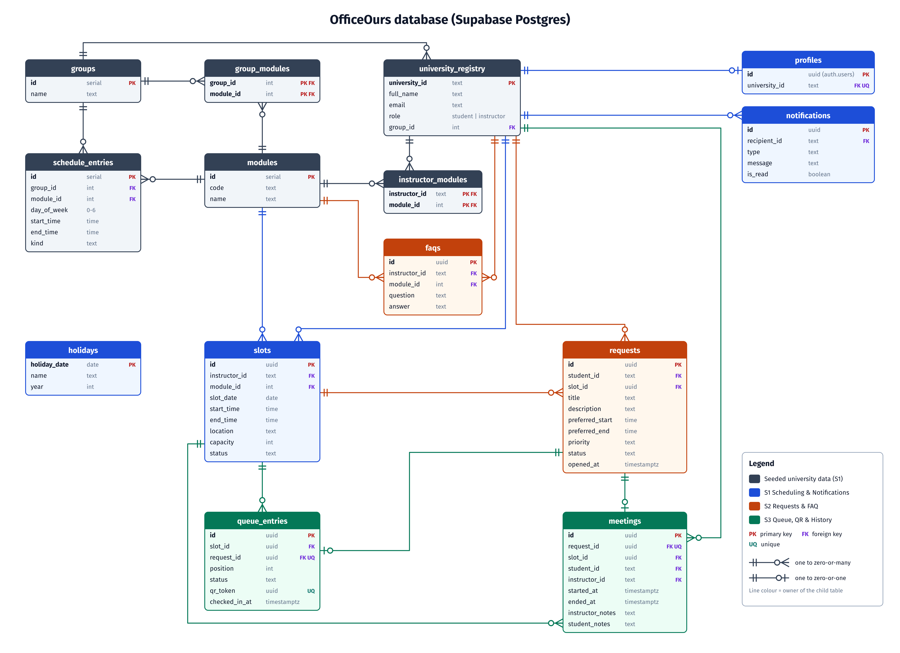</p>

14 tables on Supabase Postgres. People are identified by their university ID everywhere, so seed data works before anyone registers. Some rules live in the database too: one active request per student per slot (partial unique index), end times after start times (`CHECK`), and a request can only be queued and recorded once (unique keys).

## Project structure

```text
api/index.js              Vercel Function entry (exports the Express app)
client/                   React app
  src/api/                one API client per service + http.js
  src/pages/              scheduling/, requests/, queue/
  src/components/         navbar, footer, layout, error pages, notification bell
server/
  src/services/           auth + scheduling, requests, queue
                          routes, validation, logic, db (+ lambda, floci-setup)
  src/shared/             auth middleware, errors, events, notifications, Lambda wrapper
  scripts/                Floci setup and deploy scripts
  tests/                  Jest tests
supabase/                 schema.sql and seed.sql
docs/                     OpenAPI contract, ERD, Postman collection, README images
docker-compose.yml        Floci
vercel.json               Vercel build and routing
```

## Team

OfficeOurs is built and maintained by **Judy Tarek**, **Moheeb Abusamra** and **Ahmed Ellebishy**.

## Acknowledgements

Holiday data by [Calendarific](https://calendarific.com/). AI by [Google Gemini](https://ai.google.dev/). Email by [Brevo](https://www.brevo.com/). AWS emulation by [Floci](https://github.com/floci-io/floci). Fonts: [Bricolage Grotesque](https://fonts.google.com/specimen/Bricolage+Grotesque) and [Kalam](https://fonts.google.com/specimen/Kalam). Icons: [Lucide](https://lucide.dev/).

<p align="center"></p>
