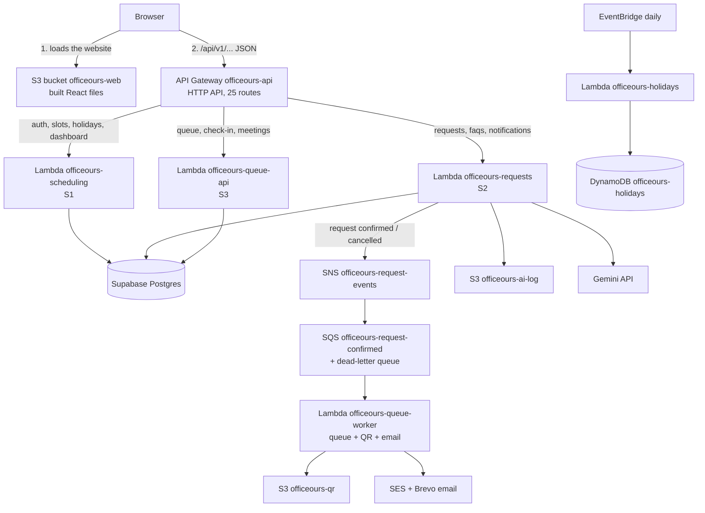
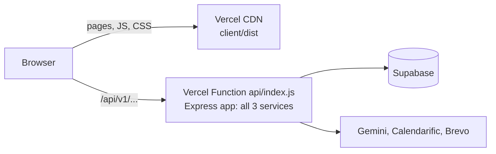

# OfficeOurs: deployment guide

The same code runs in **two deployments**, both with **Supabase** as the database:

| | Floci + Supabase | Vercel + Supabase |
|---|---|---|
| Purpose | The module's required AWS deployment, with every cloud service | A public URL anyone can open |
| Address | `http://localhost:4566/officeours-web/index.html` | `https://<project>.vercel.app` |
| Frontend | S3 bucket `officeours-web` | Vercel CDN |
| API | API Gateway -> one Lambda per service | One Vercel Function (`api/index.js`) running the Express app |
| Confirm -> queue + QR email | SNS -> SQS -> queue-worker Lambda | Same code, handled inside the function (`shared/events.js`) |
| QR images, AI log | Stored in S3 | Not stored (the QR is still attached to the email) |
| Daily holiday refresh | EventBridge -> Lambda -> DynamoDB | Not scheduled; holidays are fetched when needed |

Sections 1 to 7 cover Floci, section 8 covers Vercel.

---

## Floci + Supabase

The whole app (frontend + the 3 services' APIs) runs on **Floci**, a free local AWS emulator, with **Supabase** as the database.
One command deploys everything:

```
npm run deploy:floci --prefix server
```

and prints the website address: **http://localhost:4566/officeours-web/index.html**

---

## 1. Architecture



- **Presentation layer:** React app in the S3 bucket `officeours-web`.
- **Application layer:** API Gateway, one Lambda per service (each runs the same Express routes as local development), plus the event-driven workers.
- **Data layer:** Supabase Postgres (main database), DynamoDB (holiday cache), S3 (QR images, AI log).

Each service Lambda is built from `server/src/shared/lambda-app.js`: `serverless-http` turns the API Gateway event into an
Express request, so the deployed API and `npm run dev` share exactly the same routes, validation and error format.

---

## 2. AWS resources per service

| Service | AWS resources | Count |
|---|---|---|
| **S1 Scheduling** (Judy) | Lambda `officeours-scheduling` (API), Lambda `officeours-holidays`, DynamoDB `officeours-holidays`, EventBridge Scheduler `officeours-holidays-daily`, API Gateway `officeours-s1-api` + its routes on `officeours-api`, IAM roles | 5 services |
| **S2 Requests** (Moheeb) | Lambda `officeours-requests` (API), SNS `officeours-request-events`, S3 `officeours-ai-log`, its 6 routes on API Gateway `officeours-api`, IAM role `officeours-requests-lambda-role` | 5 services |
| **S3 Queue** (Ahmed) | Lambda `officeours-queue-api` (API), Lambda `officeours-queue-worker`, SQS `officeours-request-confirmed` + dead-letter queue, S3 `officeours-qr`, SES sender identity, IAM role | 5 services |
| **Shared** | API Gateway `officeours-api` (`$default` stage, auto-deploy), S3 `officeours-web` (public-read bucket policy) | |

**IAM (least privilege):** each Lambda has its own role that allows only what its service needs, for example
S2 may only `sns:Publish` to its topic and `s3:PutObject` under `ai-log/` in its bucket.

**External services:** Supabase (database + login), Gemini (S2 AI), Calendarific (S1 holidays), Brevo (S3 email).

---

## 3. Prerequisites

1. **Docker Desktop** running (on Windows, WSL and the Virtual Machine Platform feature must be enabled).
2. **Node.js 22+**.
3. `npm install` in `server` and in `client`.
4. `server/.env` filled in from `server/.env.example` (see section 5).

---

## 4. Deployment steps

From the repository root:

| Step | Command | What it does |
|---|---|---|
| 1 | `docker compose up -d` | Starts Floci on `http://localhost:4566` (one container, `officeours-floci`) |
| 2 | `npm run deploy:floci --prefix server` | Creates or updates every AWS resource and Lambda of the 3 services, builds the frontend against the API Gateway and uploads it to S3. Safe to run again |
| 3 | Open the printed website address | `http://localhost:4566/officeours-web/index.html` |

What `deploy:floci` runs, in order:

1. `scripts/floci-setup.mjs`
   - S3 (Ahmed): QR bucket, SQS + dead-letter queue, SNS subscription, SES identity, worker Lambda
   - S1 (Judy): DynamoDB, IAM roles, holidays Lambda, EventBridge schedule, `officeours-s1-api`
   - S2 (Moheeb): SNS topic, AI-log bucket, IAM role, `officeours-requests` Lambda + its routes
   - S1 and S3 API Lambdas + their routes (`scripts/floci-api.mjs`)
2. `scripts/floci-web.mjs`: builds the client with `VITE_API_URL=<API Gateway>/api/v1`, `VITE_USE_MOCKS=false`,
   `VITE_ROUTER=hash`, `VITE_BASE=./`, then replaces the files in the `officeours-web` bucket.

Other commands:

| Command | Use |
|---|---|
| `npm run floci:setup --prefix server` | Resources and Lambdas for **local development** (QR links point to `http://localhost:5173`) |
| `npm run deploy:web --prefix server` | Rebuild and re-upload only the frontend |
| `npm run dev --prefix server` | Local Express API on port 3000 (development, tests) |

---

## 5. Configuration (environment variables)

All secrets live in `server/.env` (never committed). The deploy copies the values each Lambda needs into that Lambda's own environment.

| Variable | Used by | Purpose |
|---|---|---|
| `SUPABASE_URL`, `SUPABASE_SECRET_KEY` | all Lambdas | Database and login |
| `GEMINI_API_KEY`, `GEMINI_MODEL` | S2 Lambda | AI FAQ check and FAQ ideas |
| `CALENDARIFIC_API_KEY` | S1 Lambdas | Egypt holidays |
| `BREVO_API_KEY`, `BREVO_SENDER_EMAIL`, `BREVO_SENDER_NAME` | S3 Lambdas | Ticket email |
| `AWS_ENDPOINT_URL` | server, deploy scripts | Floci address (`http://localhost:4566`); empty = cloud features off |
| `AWS_REGION`, `AWS_ACCESS_KEY_ID`, `AWS_SECRET_ACCESS_KEY` | deploy scripts | Any value works on Floci (`test`) |
| `SNS_TOPIC_ARN`, `AI_LOG_BUCKET` | S2 | Event topic and AI log bucket (printed by the setup) |
| `S3_BUCKET`, `SQS_QUEUE_URL`, `QUEUE_LAMBDA_NAME`, `SES_SENDER_EMAIL` | S3 | Printed by the setup |
| `CLIENT_URL` | Lambdas (CORS) | Allowed frontend; the deploy always adds the Floci website (`http://localhost:4566`) |
| `CHECKIN_BASE_URL` | S3 Lambdas | Where QR codes point; `deploy:floci` sets it to `.../index.html#` |
| `TEST_PASSWORD` | Jest tests | Password of the test accounts |

Inside a Lambda container, Floci is reached as `http://floci:4566` (Docker network), not `localhost`.

---

## 6. Checking that it works

| Check | How | Expected |
|---|---|---|
| API Gateway → Lambda | `curl.exe "<API URL>/api/v1/health"` | `{"data":{"status":"ok","service":"officeours-scheduling"}}` |
| Login through API Gateway | `POST <API URL>/api/v1/auth/login` | A token, answered by the S1 Lambda |
| Each service | `GET /slots`, `/requests`, `/meetings` with the token | Data from Supabase, each from its own Lambda |
| Website | Open the website address, DevTools → Network | API calls go to `http://<id>.execute-api.localhost.floci.io:4566/api/v1/...` |
| SNS → SQS → worker | Confirm a request in the Inbox | QR email with a link to `.../index.html#/check-in/<token>` |
| AI log | `http://localhost:4566/officeours-ai-log` | One `ai-log/<date>/...json` per AI check |
| QR images | `http://localhost:4566/officeours-qr` | `qr/<token>.png` |
| Floci's own log | `docker logs officeours-floci --tail 40` | The AWS calls it received |

---

## 7. Limitations

| Issue | Reason | Proposed improvement |
|---|---|---|
| The website address is `localhost` | Floci is a local emulator | A tunnel (Cloudflare Tunnel or ngrok) for a public URL, or real AWS with the same scripts |
| Page links contain `#` | The bucket serves files only; S3 website hosting is not confirmed on Floci | S3 website hosting or CloudFront with `index.html` as the error page |
| On Floci, the queue worker still needs `npm run dev` | The SQS -> worker Lambda trigger (event source mapping) is not added yet; the local server polls the queue | Add the event source mapping in the queue service's setup (planned) |
| First request to a Lambda takes a few seconds | Floci starts a container per Lambda (cold start) | Keep-warm pings, or provisioned concurrency on real AWS |
| IAM policies are not enforced | Floci accepts every call | Real AWS enforces the same policies as written |
| Vercel: QR images and the AI log are not stored | There is no S3 on Vercel | Vercel Blob storage, or real AWS S3 |
| Vercel: no daily holiday refresh | There is no EventBridge on Vercel | A Vercel Cron Job calling a refresh endpoint |
| Vercel: dates near midnight can be off by a day | Vercel servers run on UTC, the app uses the server's local date | Compute dates in `Africa/Cairo` explicitly |

---

## 8. Vercel + Supabase (public deployment)

**One Vercel project** serves everything from one address:



| File | What it does |
|---|---|
| `vercel.json` | Installs `server` and `client`, builds the React app with `VITE_API_URL=/api/v1` and mocks off, sends `/api/*` to the function and every other path to `index.html` (so links like `/student/requests` work) |
| `api/index.js` | Exports the Express app from `server/src/index.js` as the function |
| `server/src/index.js` | Does not open a port when `VERCEL` is set (Vercel runs it per request) |
| `server/src/shared/events.js` | Without SNS, "request confirmed" is handled in the same function: queue entry, QR code, email |

The frontend and the API share one address, so there is no CORS setup.

### Steps (Vercel dashboard)

1. **vercel.com -> Add New -> Project**, import the GitHub repository.
2. **Root Directory:** leave it as the repository root. **Framework Preset:** Other (`vercel.json` sets the install, build and output).
3. **Environment Variables** (Settings -> Environment Variables), copied from `server/.env`:

   | Variable | Value |
   |---|---|
   | `SUPABASE_URL`, `SUPABASE_SECRET_KEY` | From Supabase |
   | `GEMINI_API_KEY`, `GEMINI_MODEL` | Gemini key, `gemini-3.5-flash-lite` |
   | `CALENDARIFIC_API_KEY` | Calendarific key |
   | `BREVO_API_KEY`, `BREVO_SENDER_EMAIL`, `BREVO_SENDER_NAME` | Brevo |
   | `APP_TIMEZONE` | `Africa/Cairo` |
   | `CLIENT_URL`, `CHECKIN_BASE_URL` | `https://<project>.vercel.app` (QR codes open `/check-in/<token>` there) |

   Do **not** set `AWS_ENDPOINT_URL`, `SNS_TOPIC_ARN` or the other Floci values: without them the AWS parts switch off.
4. **Deploy.** Then put the real address in `CLIENT_URL` and `CHECKIN_BASE_URL` and redeploy once.
5. Every push to the production branch (`main` by default) redeploys; other branches get preview URLs.

Optional: Settings -> Functions -> Region close to the Supabase project's region, for faster database calls.

### Checking it

| Check | Expected |
|---|---|
| `https://<project>.vercel.app/api/v1/health` | `{"data":{"status":"ok"}}` |
| Open the site, log in, book, run the AI check | Works like local development |
| Confirm the request as the instructor | The student is queued and gets the QR email, its link opens `.../check-in/<token>` on Vercel |
| Vercel dashboard -> Logs | One line per API call, plus `[events] RequestConfirmed handled in-process` |
